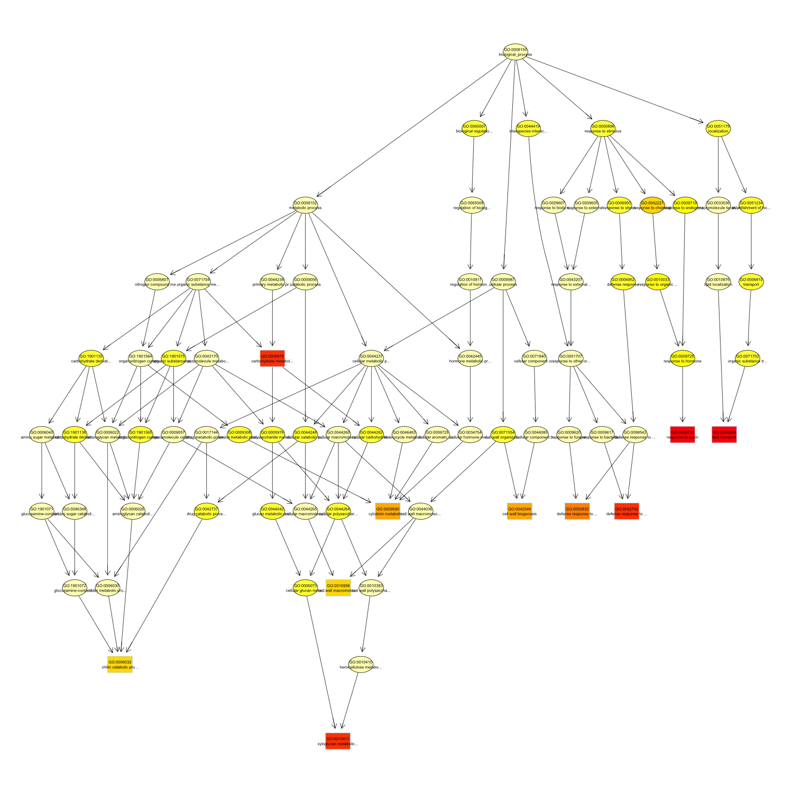

# RNA-seq実習コマンドリスト（3日目）

RNA-seq解析実習で使うRコードと、その目的・結果の読み方をまとめる。

## 3日目に行うこと

2日目は、コントロール群と低温処理群を比較し、発現変動遺伝子（DEGs）を検出した。

3日目は、DEGsにどのような機能を持つ遺伝子が多く含まれるかを、GOエンリッチメント解析で調べる。  
また、遺伝子の具体的な機能の調べ方を紹介する。

引き続き`ngs.Rproj`を開き、同じR Markdownファイルにコード・結果・考察を記録する。

2日目のオブジェクトがRに残っていなくても実行できるように、保存した結果ファイルを読み込む。

## 6. GOエンリッチメント解析（Gene Ontology Enrichment Analysis）

### GOとは？

GO（Gene Ontology）は、遺伝子産物の機能や働く場所を、共通の語彙で記述する仕組みである。

次の3つの分類がある。

| 略称 | 分類               | 表すもの               |
| ---- | ------------------ | ---------------------- |
| BP   | Biological Process | 関与する生物学的な過程 |
| MF   | Molecular Function | 分子としての機能       |
| CC   | Cellular Component | 働く細胞内の場所や構造 |

1つの遺伝子に、複数のGO項目が対応する場合がある。

また、GO項目は独立した一覧ではなく、広い概念と具体的な概念がつながった階層構造を持つ。

### GO項目は階層構造を持つ

GO項目は、独立した機能名を並べたものではない。広い概念と、より具体的な概念がつながった構造を持っている。

次の図は、別の解析で作成したBPの階層図の例である。今回の実習データの結果ではない。



**図：BPのGO項目間の関係の例。** 各図形はGO項目、線は項目間の関係を示す。GO全体のうち、解析結果に関連する一部の項目を表示している。

#### 広い概念から具体的な概念へ

図の最上部には、BP全体を表す`biological_process`がある。その下には、`metabolic process`（代謝過程）や`response to stimulus`（刺激への応答）などの広い概念が配置されている。

例えば、図の右側では、次のようなつながりをたどることができる。

**刺激への応答 → 化学物質への応答 → ホルモンへの応答 → オーキシンへの応答**

この図では、上から下へ進むほど、対象が具体的になっている。ただし、図の上下や矢印の向きは描画方法によって異なるため、他の図でも同じとは限らない。

#### 1つの項目が複数の上位項目につながる

GOは、各項目が必ず1つの親だけを持つ単純な樹形図ではない。1つの項目が複数の上位項目につながる場合がある。

項目間の関係には、「〜の一種である（is a）」や「〜の一部である（part of）」などがある。そのため、GOは枝が分かれるだけでなく、複数の枝がつながるネットワークとして表される。

#### なぜ似たGO項目が解析結果に並ぶのか？

例えば、「オーキシンへの応答」に関連する遺伝子は、より広い「ホルモンへの応答」や「刺激への応答」の集計にも含まれうる。

そのため、同じ遺伝子群の影響で、関連する複数のGO項目がエンリッチメント解析の結果に現れることがある。

**似たGO項目が複数出たことを、その数だけ独立した生物学的現象が見つかったと解釈してはいけない。** 項目間の関係や、含まれる遺伝子の重複も確認する必要がある。

今回使うtopGOの`elim`法は、このような階層構造による影響を抑えることを目的とした方法である。ただし、項目間の重複や依存がすべてなくなるわけではない。

実習では階層図を作成せず、棒グラフで結果を表示する。棒グラフには項目間のつながりが描かれないが、その背後にはこのような構造があることを意識して読む。

> **なんのためにやっている？**  
> 「ホルモンへの応答」と「オーキシンへの応答」が両方検出された場合、それらを独立した結果として数えてよいか？ GOの階層構造を踏まえて説明すること。

### GOエンリッチメント解析とは？

ある機能を持つ遺伝子が、調べたい遺伝子集合に、背景と比べて多く含まれるかを検定する方法である。

例えば、あるGO項目に関連する遺伝子が、背景遺伝子集合では2%、DEGsでは10%含まれていたとする。この項目はDEGsで多いように見えるが、統計的に判断するには、割合だけでなく遺伝子数も考慮する必要がある。

今回比較するのは、次の2つである。

- **選択遺伝子集合**：発現が上昇、または低下したDEGs
- **背景遺伝子集合**：2日目の発現変動検定の対象になった遺伝子を出発点とし、IDとGO情報を対応させられるもの

ゲノム上の全遺伝子を、そのまま背景にするわけではない。

また、GO解析はGO項目の過剰な出現を調べるものであり、代謝経路そのものの解析とは区別する。

> **なんのためにやっている？**  
> DEGを1つずつ調べることに加え、遺伝子集合として機能の偏りを調べると、どのような情報が得られるか？

実習では、GOの3分類のうち、**BP（Biological Process：生物学的過程）**について、上昇遺伝子と低下遺伝子を分けて解析する。

### 6-1. 必要なパッケージの読み込み

#### ステップ1：パッケージを読み込む

```r
library(topGO)
library(org.At.tair.db)
library(ggplot2)
```

- `topGO`：GOエンリッチメント解析
- `org.At.tair.db`：Arabidopsisの遺伝子とGOなどの対応情報
- `ggplot2`：結果の作図

パッケージがない場合は、教員やTAに確認する。インストールは実習前に済ませておき、毎回実行する解析チャンクには含めない。

#### ステップ2：保存先と入力ファイルを確認する

```r
dir.create(
  "results/go",
  recursive = TRUE,
  showWarnings = FALSE
)

comp_file <- "results/expression/Comp.txt"

stopifnot(file.exists(comp_file))

getwd()
```

### 6-2. 入力データの準備

#### ステップ1：2日目の検定結果を読み込む

背景遺伝子も必要なので、DEGsだけを保存した`DEGs.txt`ではなく、検定した全遺伝子を含む`Comp.txt`を読む。

```r
df <- read.delim(
  comp_file,
  header = TRUE,
  row.names = 1,
  sep = "\t",
  check.names = FALSE
)

head(df)
colnames(df)

stopifnot(
  all(c("logFC", "PValue", "FDR") %in% colnames(df)),
  is.numeric(df$logFC),
  is.numeric(df$FDR),
  all(is.finite(df$logFC)),
  all(is.finite(df$FDR)),
  all(df$FDR >= 0 & df$FDR <= 1)
)

df$original_ID <- rownames(df)
```

QL法の結果には`F`列が含まれる。列名を手動で`LR`などに置き換えず、保存された列名を使う。

#### ステップ2：遺伝子IDを確認する

```r
head(df$original_ID, 20)
```

今回使うアノテーションは、`AT1G01010`のようなTAIR遺伝子IDに対応する。

入力IDに`gene:`や`transcript:`という接頭辞、末尾に`.1`などが付いている場合に備え、照合用IDを作る。元のIDは残しておく。

```r
df$ID <- trimws(df$original_ID)

df$ID <- sub(
  "^(gene:|transcript:)",
  "",
  df$ID
)

df$ID <- sub(
  "\\.[0-9]+$",
  "",
  df$ID
)

head(df[, c("original_ID", "ID")], 20)
```

**文字列を整えることと、転写産物単位の解析を遺伝子単位の解析に変換することは別である。**

変換後のIDが重複していないか確認する。

```r
duplicated_ids <- unique(
  df$ID[duplicated(df$ID)]
)

head(duplicated_ids, 20)

if (length(duplicated_ids) > 0L) {
  stop(
    "変換後の遺伝子IDが重複しています。",
    "教員・TAに解析単位を確認してください。"
  )
}
```

複数転写産物の中から最小FDRの行を選ぶ、といった処理はここでは行わない。

#### ステップ3：DEGの条件を2日目とそろえる

2日目と同じ条件を使う。

- `FDR < 0.01`
- `|logFC| >= 1`

さらに、発現上昇と発現低下を分ける。

```r
df$isDEG <- with(
  df,
  FDR < 0.01 & abs(logFC) >= 1
)

df$isUp <- with(
  df,
  FDR < 0.01 & logFC >= 1
)

df$isDown <- with(
  df,
  FDR < 0.01 & logFC <= -1
)

data.frame(
  tested = nrow(df),
  DEG = sum(df$isDEG),
  Up = sum(df$isUp),
  Down = sum(df$isDown)
)
```

上昇と低下をまとめると、同じ機能に関係する遺伝子でも、変化の方向が混在する。そのため、今回は別々に解析する。

ただし、上昇遺伝子にあるGO項目が多く含まれても、その生物学的過程全体が「活性化した」と直ちに断定することはできない。

#### ステップ4：アノテーションに対応するIDを選ぶ

```r
valid_ids <- AnnotationDbi::keys(
  org.At.tair.db,
  keytype = "TAIR"
)

id_matched <- df$ID %in% valid_ids

data.frame(
  tested = nrow(df),
  ID_matched = sum(id_matched),
  ID_unmatched = sum(!id_matched)
)

head(df$original_ID[!id_matched], 20)

df2 <- df[id_matched, , drop = FALSE]

stopifnot(nrow(df2) > 0L)
```

対応しなかったIDは、確認できるよう保存する。

```r
write.table(
  df[!id_matched, , drop = FALSE],
  file = "results/go/unmatched_IDs.txt",
  sep = "\t",
  quote = FALSE,
  row.names = FALSE
)
```

GO解析の対象になった遺伝子一覧も保存する。

```r
write.table(
  df2,
  file = "results/go/GO_input_genes.txt",
  sep = "\t",
  quote = FALSE,
  row.names = FALSE
)
```

IDが対応しなかったことは、「機能がない」ことを意味しない。ID形式やアノテーションの収録範囲・更新時期なども影響する。

> **なんのためにやっている？**  
> 入力した遺伝子のうち、アノテーションと対応できた数を確認するのはなぜか？

### 6-3. gene universe（背景遺伝子集合）の作成

#### ステップ1：背景と選択遺伝子を区別する

背景は、DEGとして選ばれる可能性があった遺伝子の集合である。

今回は、2日目の低発現フィルタリングを通過し、検定の対象となった遺伝子を出発点とする。

そのうちTAIR IDに対応するものが`df2`である。さらに、各分類のGO情報を持つ遺伝子が、topGOで実際に比較に使われる。

上昇・低下の解析では、**同じ背景を使い、選択する遺伝子だけを変える。**

#### ステップ2：上昇遺伝子を選択した背景を作る

topGOには、遺伝子ごとの選択状態を、名前付きのfactorとして渡す。

```r
gene_universe_up <- factor(
  as.integer(df2$isUp),
  levels = c(0, 1)
)

names(gene_universe_up) <- df2$ID

table(gene_universe_up)
head(gene_universe_up)
```

- `1`：上昇DEG
- `0`：背景に含まれる、それ以外の遺伝子

この時点では、GO情報があるかどうかまでは区別していない。次のステップでアノテーションを対応させる。

> **なんのためにやっている？**  
> DEGだけの一覧ではなく、背景遺伝子と選択状態の両方を用意するのはなぜか？

### 6-4. topGOデータの作成と検定

#### ステップ1：遺伝子とGOの対応表を作る

```r
go_map <- AnnotationDbi::select(
  org.At.tair.db,
  keys = df2$ID,
  keytype = "TAIR",
  columns = c("GO", "ONTOLOGY")
)

head(go_map)
```

1つの遺伝子に複数のGO項目が対応するため、同じ遺伝子IDが複数行に現れる。

GO情報のない行を除き、遺伝子ごとのGO一覧に変換する。

```r
go_map <- unique(
  go_map[
    !is.na(go_map$GO),
    c("TAIR", "GO", "ONTOLOGY"),
    drop = FALSE
  ]
)

gene2GO <- split(
  go_map$GO,
  go_map$TAIR
)

gene2GO <- lapply(gene2GO, unique)

head(gene2GO)
```

#### ステップ2：検定方法を理解する

今回は、昨年と同じく次を使う。

- **Fisherの正確確率検定**
- **elimアルゴリズム**

Fisher検定は、背景と選択遺伝子におけるGO項目の出現を比較する。

GOには階層構造があるため、具体的な項目に関連する遺伝子は、広い上位項目にも関連する。`elim`は、このつながりによって似た結果が繰り返し現れる影響を抑えることを目的とした方法である。

ただし、**elimが返すp値はFDRではない。** 今回は`elim p < 0.05`を探索的な表示基準とし、多重検定補正後の有意性を保証する基準としては扱わない。

#### ステップ3：解析を行う関数を定義する

同じ処理を、BP・MF・CCと上昇・低下のそれぞれに適用できるよう、関数を作る。

```r
run_topgo <- function(ontology, selected, label) {

  # 背景遺伝子に選択状態を付ける
  gene_universe <- factor(
    as.integer(selected),
    levels = c(0, 1)
  )

  names(gene_universe) <- df2$ID

  # GO情報を対応させる
  GOdata <- new(
    "topGOdata",
    ontology = ontology,
    allGenes = gene_universe,
    nodeSize = 10,
    annot = annFUN.gene2GO,
    gene2GO = gene2GO
  )

  # この分類で実際に背景となる遺伝子
  feasible <- genes(GOdata)

  n_selected <- sum(
    selected[match(feasible, df2$ID)]
  )

  message(
    label,
    "：GO情報に対応した背景遺伝子数 = ",
    length(feasible),
    "、そのうち選択遺伝子数 = ",
    n_selected
  )

  if (
    n_selected == 0L ||
    n_selected == length(feasible)
  ) {
    message(
      "比較できる選択遺伝子・非選択遺伝子が不足しています。"
    )
    return(NULL)
  }

  # elim法とFisher検定
  test <- runTest(
    GOdata,
    algorithm = "elim",
    statistic = "fisher"
  )

  pvalues <- score(test)

  # 全項目の結果表を作る
  result_table <- GenTable(
    GOdata,
    elimFisher = test,
    orderBy = "elimFisher",
    ranksOf = "elimFisher",
    topNodes = length(pvalues),
    numChar = 1000
  )

  # 表示用に丸められた文字列ではなく、
  # 検定結果の数値を直接使う
  result_table$elimFisher <- unname(
    pvalues[result_table$GO.ID]
  )

  result_table <- result_table[
    order(
      result_table$elimFisher,
      result_table$GO.ID
    ),
    ,
    drop = FALSE
  ]

  rownames(result_table) <- NULL

  write.table(
    result_table,
    file = paste0(
      "results/go/topGO_", label, "_table.txt"
    ),
    sep = "\t",
    quote = FALSE,
    row.names = FALSE
  )

  list(
    data = GOdata,
    test = test,
    table = result_table
  )
}
```

`nodeSize = 10`は、この背景で関連遺伝子が10個未満のGO項目を検定対象から除く指定である。DEGが10個必要という意味ではない。

#### ステップ4：BPについて上昇・低下遺伝子を解析する

```r
BP_up <- run_topgo(
  ontology = "BP",
  selected = df2$isUp,
  label = "BP_up"
)

BP_down <- run_topgo(
  ontology = "BP",
  selected = df2$isDown,
  label = "BP_down"
)
```

結果の先頭を確認する。

```r
if (!is.null(BP_up)) {
  head(BP_up$table, 10)
}

if (!is.null(BP_down)) {
  head(BP_down$table, 10)
}
```

#### ステップ5：結果表を読む

| 列            | 意味                                   |
| ------------- | -------------------------------------- |
| `GO.ID`       | GO項目のID                             |
| `Term`        | GO項目名                               |
| `Annotated`   | そのGO項目に関連する背景遺伝子数       |
| `Significant` | そのGO項目に関連する選択遺伝子数       |
| `Expected`    | 偏りがない場合に期待される選択遺伝子数 |
| `elimFisher`  | elim法とFisher検定から得られたp値      |

`Significant`という列名は、ここでは**入力として選択したDEGの数**を表す。GO項目そのものが統計的に有意である、という意味ではない。

また、`Annotated`・`Significant`・`Expected`はGO項目への元の対応に基づく集計である。elim法では検定中に一部の遺伝子を除くため、これらの数だけから`elimFisher`を再現できるとは限らない。

> **なんのためにやっている？**  
> GO項目名とp値だけでなく、その項目に関連する背景遺伝子数とDEG数も確認するのはなぜか？

### 6-5. 遺伝子のFDRとGO項目のp値を区別する

今回の解析には、異なる対象についての統計量が登場する。

| 統計量              | 対象                 | 今回の使い方                       |
| ------------------- | -------------------- | ---------------------------------- |
| edgeRの`FDR`        | 各遺伝子の発現変動   | `FDR < 0.01`と変動量でDEGを選ぶ    |
| topGOの`elimFisher` | 各GO項目の過剰な出現 | `p < 0.05`を探索的な表示基準にする |

GO解析の選択遺伝子はedgeRの結果から作っている。したがって、この2段階の解析は無関係・独立という意味ではない。

また、GO解析のp値は、次を意味しない。

- その機能が関与している確率
- そのGO項目が誤りである確率
- 多重検定補正後のFDR
- その機能が活性化・抑制された程度

GO項目は多数検定しているため、今回の`p < 0.05`を満たす項目には、偶然によるものも含まれうる。機能を考えるための候補として扱う。

> **なんのためにやっている？**  
> DEGを選ぶときのFDRと、GO解析のp値は、それぞれ何についての統計量か？

### 6-6. GO解析結果を棒グラフで可視化

#### ステップ1：表示する項目を決める

今回は、`elim p < 0.05`を満たす項目のうち、p値が小さい順に最大20項目を表示する。

該当項目が20未満なら、その項目数だけ描く。該当項目がなければ図を作らない。

#### ステップ2：作図する関数を定義する

```r
plot_go <- function(result, title, fill_color) {

  if (is.null(result)) {
    return(NULL)
  }

  tab <- result$table

  tab <- tab[
    is.finite(tab$elimFisher) &
      tab$elimFisher < 0.05,
    ,
    drop = FALSE
  ]

  tab <- head(tab, 20L)

  if (nrow(tab) == 0L) {
    message(
      "elim p < 0.05を満たす項目はありません。"
    )
    return(NULL)
  }

  # GO IDで並び順を固定する
  tab$GO.ID <- factor(
    tab$GO.ID,
    levels = rev(tab$GO.ID)
  )

  # 長い項目名を折り返す
  term_labels <- vapply(
    tab$Term,
    function(x) {
      paste(strwrap(x, width = 45), collapse = "\n")
    },
    character(1)
  )

  axis_labels <- setNames(
    paste(
      term_labels,
      as.character(tab$GO.ID),
      sep = "\n"
    ),
    as.character(tab$GO.ID)
  )

  ggplot(
    tab,
    aes(
      x = GO.ID,
      y = -log10(
        pmax(elimFisher, .Machine$double.xmin)
      )
    )
  ) +
    geom_col(fill = fill_color) +
    coord_flip() +
    scale_x_discrete(labels = axis_labels) +
    labs(
      title = title,
      subtitle = paste0(
        "Exploratory: elim p < 0.05; ",
        "up to 20 terms"
      ),
      x = NULL,
      y = "-log10(elim p-value)"
    ) +
    theme_bw(base_size = 11) +
    theme(
      panel.grid.minor = element_blank()
    )
}
```

表に表示された`"< 1e-30"`などの文字列を数値に変換するのではなく、検定結果から取り出した数値を使う。

#### ステップ3：BPの結果を描いて保存する

上昇遺伝子の結果を描く。

```r
BP_up_plot <- plot_go(
  BP_up,
  title = "GO enrichment: BP, up-regulated genes",
  fill_color = "#D55E00"
)

if (!is.null(BP_up_plot)) {
  print(BP_up_plot)

  ggsave(
    filename = "results/go/GO_BP_up_barplot.png",
    plot = BP_up_plot,
    width = 10,
    height = 10,
    dpi = 300,
    bg = "white"
  )
}
```

低下遺伝子の結果を描く。

```r
BP_down_plot <- plot_go(
  BP_down,
  title = "GO enrichment: BP, down-regulated genes",
  fill_color = "#0072B2"
)

if (!is.null(BP_down_plot)) {
  print(BP_down_plot)

  ggsave(
    filename = "results/go/GO_BP_down_barplot.png",
    plot = BP_down_plot,
    width = 10,
    height = 10,
    dpi = 300,
    bg = "white"
  )
}
```

#### ステップ4：図を読む

- 棒が長いほど、elimのp値が小さい。
- 棒の長さは、発現変動量やDEG数を表していない。
- 意味の似たGO項目は、同じ遺伝子を共有している場合がある。
- 上昇・低下の両方に同じ項目が出る場合もある。
- 上昇・低下でのp値の大小は、両者の違いを直接検定した結果ではない。

項目名だけで結論を出さず、結果表に戻り、関連する遺伝子数も確認する。

> **なんのためにやっている？**  
> 今回の棒グラフの長さは何を表しているか？ 「棒が長いほど強く活性化した」と解釈できない理由も説明すること。

#### ステップ5：気になるGO項目に含まれる遺伝子を確認する

例として、上昇遺伝子のBP解析で、先頭にあるGO項目を確認する。

```r
if (!is.null(BP_up)) {

  target_go <- BP_up$table$GO.ID[1]

  # このGO項目に関連する背景遺伝子
  term_genes <- genesInTerm(
    BP_up$data,
    whichGO = target_go
  )[[1]]

  # そのうち上昇DEGである遺伝子
  related_up <- df2[
    df2$ID %in% term_genes & df2$isUp,
    c("ID", "logFC", "FDR"),
    drop = FALSE
  ]

  print(target_go)
  print(BP_up$table$Term[1])
  print(related_up)
}
```

これは、そのGO項目に関連する上昇DEGの一覧である。elimの検定途中に除かれた遺伝子の有無とは区別する。

GO項目のp値だけでなく、どの遺伝子が含まれるかを確認することが、生物学的な解釈につながる。

## 7. 発現変動遺伝子の機能を調べる

GO解析では、遺伝子集合に含まれる機能の偏りを調べた。次は、個々の遺伝子に注目し、データベースを使って機能を調べる。

### ステップ1：調べる遺伝子を選ぶ

2日目に検出した上昇DEG、すなわち`FDR < 0.01`かつ`logFC >= 1`を満たす遺伝子から、FDRが最小の遺伝子を選ぶ。同じFDRの場合はp値が小さいものを選び、両方同じ場合は同順位として記録する。

選んだ遺伝子のID、logFC、FDRをR Markdownに記録する。

**統計的に最も有意な遺伝子が、発現変動量の最大の遺伝子や、生物学的に最も重要な遺伝子とは限らない。**

### ステップ2：遺伝子IDで検索する

TAIR、UniProt、Ensembl Plantsで検索する。検索結果では、対象が*Arabidopsis thaliana*であることと、遺伝子IDが一致することを確認する。

転写産物やタンパク質のIDが表示された場合は、調べている遺伝子との対応を確認する。

### ステップ3：機能と、その根拠を調べる

次の情報を整理する。

- 遺伝子名・別名と、コードするタンパク質
- 生物学的な役割、分子機能、細胞内局在
- 機能の説明が、実験に基づくものか、相同性などによる推定か
- 根拠となる論文やデータベースのページ

機能が十分に分かっていない場合は、そのこと自体を記録する。情報が見つからないことを、機能がないことと解釈しない。

参照したページのURLと閲覧日を記録する。

### ステップ4：今回の発現変動と結び付ける

調べた機能を踏まえ、この遺伝子の発現上昇が低温処理とどのように関係する可能性があるかを考える。

データベースや文献に記載された事実と、今回の結果から自分が考えた仮説を分けて書く。RNA量の増加だけから、タンパク質量や活性の増加まで断定しないこと。

> **なんのためにやっている？**  
> 遺伝子の機能名を調べるだけでなく、その記述の根拠まで確認するのはなぜか？

## 最後に：結果の保存と再実行の確認

主な出力を確認する。

| 保存先                               | 内容                                |
| ------------------------------------ | ----------------------------------- |
| `results/go/GO_input_genes.txt`      | IDが対応した検定対象遺伝子とDEG判定 |
| `results/go/unmatched_IDs.txt`       | TAIR IDに対応しなかった入力         |
| `results/go/topGO_BP_up_table.txt`   | BP・上昇遺伝子の全結果              |
| `results/go/topGO_BP_down_table.txt` | BP・低下遺伝子の全結果              |
| `results/go/GO_*_barplot.png`        | 作成した棒グラフ                    |

表示基準を満たす項目がない場合、棒グラフは保存されない。これは作図エラーとは異なる。

使用したRとパッケージのバージョンを記録する。

```r
sessionInfo()
```

最後に、R Markdownを最初からKnitし、保存済みの`Comp.txt`からGO解析の結果を再現できることを確認する。